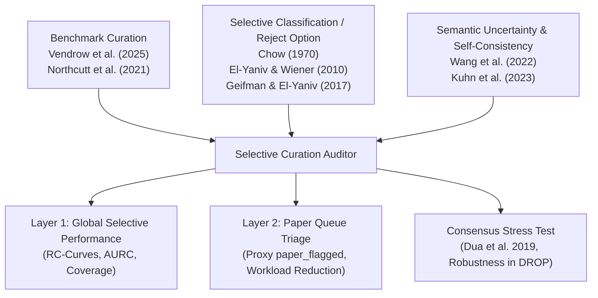
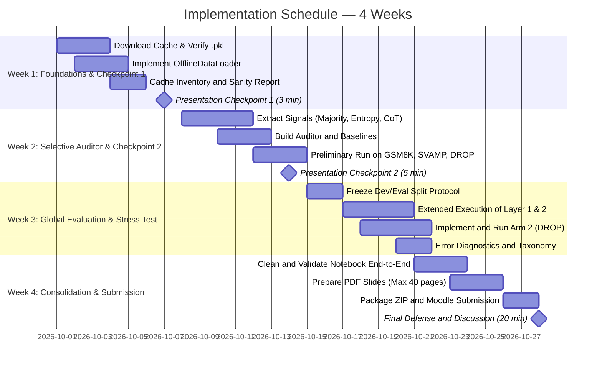

# Research Project Proposal: Selective Triage and Post-Hoc Auditing for Scalable LLM Benchmark Curation

> **Course:** Advanced Topics in Machine Learning (TAAC / M.IA009) — Master in Artificial Intelligence, University of Porto  
> **Base Paper:** *Do Large Language Model Benchmarks Test Reliability?* (Vendrow, Vendrow, Beery & Mądry; MIT / arXiv:2502.03461, 2025)  
> **Working Repository:** `platinum-benchmarks-fork` (Fork of the official repository `MadryLab/platinum-benchmarks`)  
> **Authors / Team:** Group of 3 MSc AI Students (Student A, Student B, Student C)  
> **Duration:** 4 Weeks (Milestones: Checkpoint 1 [10%], Checkpoint 2 [25%], Final Submission and Defense [50% + 15%])  
> **Document Status:** Final Technical and Methodological Specification (Self-Contained and Directly Executable)

---

## 1. Executive Summary and General Framing

### 1.1 The Problem and the Opportunity
The empirical evaluation of Large Language Models (LLMs) relies heavily on benchmarks designed to measure reasoning, comprehension, and factual verification capabilities. However, recent studies — prominently Vendrow et al. (2025) — have demonstrated that even the most established benchmarks in the community (such as GSM8K, SVAMP, DROP, and SQuAD2.0) contain substantial noise rates, including mislabeled targets, ambiguous statements, and poorly written problems. To demonstrate that frontier LLMs still fail on elementary tasks, the authors constructed the *Platinum Benchmarks*, applying a manual curation process to subsets of 15 popular benchmarks.

The curation methodology adopted in the base paper rests on a conservative heuristic: **a question is inspected manually whenever at least one model in the evaluated pool makes an error** relative to the original target. While this procedure guarantees high purity in reviewed subsets, it imposes a critical bottleneck: **a lack of scalability**. Manually inspecting every isolated disagreement across datasets with tens or hundreds of thousands of instances is financially prohibitive and operationally unfeasible. Additionally, the process contains a theoretical blind spot: if a question is intrinsically ambiguous or contains a shared formulation error, but all models converge on the same incorrect answer, no divergence is generated and the flaw goes unnoticed in the original audit.

### 1.2 Proposed Solution
We propose an approach grounded in the literature on **Selective Classification / Learning to Defer** to automate triage in LLM benchmark curation:

1. **Offline Post-Hoc Selective Auditor (Arm 1 — Primary Contribution):**  
   Build an algorithmic triage system that operates strictly on the precomputed model outputs available in the paper's official public cache (`madrylab/platinum-bench-paper-cache`). The auditor extracts multiple observable uncertainty signals — majority voting margin, vote distribution entropy, and semantic textual coherence across reasoning chains (*Chain-of-Thought* / justifications) — to compute a continuous selective confidence score $S(x) \in [0, 1]$. The system operates under a strict routing policy:
   - **High Score ($S(x) \ge \tau$):** The example is *provisionally accepted* for the benchmark, bypassing immediate human review under a controlled statistical risk ceiling.
   - **Low Score ($S(x) < \tau$):** The example is *deferred* to the prioritized human inspection queue.
   - **Incomplete Cache or Structural Parsing Failure:** The example is compulsorily routed to human review (`defer_mandatory`).

2. **Controlled Stress Test and Sensitivity Study (Arm 2 — Secondary Experiment):**  
   Investigate the structural blind spot of cross-model consensus. From a selected subset of instances that achieved unanimous consensus and automatic acceptance in Arm 1 (focusing specifically on the `DROP` benchmark, where Vendrow et al. identified the *first-event bias* phenomenon), we apply controlled semantic perturbations (temporal inversions with traceable answer changes) in contrast with invariant textual placebos. This arm empirically evaluates whether observed consensus reflects genuine factual solidity or shared fragility among LLMs.

### 1.3 Epistemological and Operational Scoping
To ensure absolute methodological rigor, we establish the following non-negotiable premises:
- **Triage vs. Truth Classifier:** The auditor is **not** an oracle or a classifier that certifies the mathematical or factual truth of a question. "Accepting" solely means that observable evidence across ensemble predictions does not justify allocating scarce expert human time. "Deferring" is an algorithmic queuing decision; "inspecting" is the subsequent human action.
- **Queue Reduction as an Empirical Hypothesis:** The reduction of human review burden **is not assumed a priori**, but treated as a testable scientific hypothesis. If, under a 5% error tolerance threshold, the dispersion of disagreements prevents safe acceptance of instances with dissenting minority votes, that finding constitutes a highly valuable scientific result on the limits of observable consistency.
- **Consolidated Project Statement:**
  > *We investigate whether a post-hoc selective auditor, strictly blind to ground truth during inference and based solely on precomputed responses from an LLM ensemble, can automate triage in benchmark curation, reducing the human inspection queue under parametric risk constraints. We evaluate coverage and selective risk against the `platinum_target` (treated as an operational reference), measure effort reduction relative to a reproducible proxy of the original paper's rule, and analyze the fragility of unanimous consensus via a focused stress test.*

---

## 2. Theoretical Context, Base Paper, and Related Literature

### 2.1 Critical Analysis of the Base Paper (Vendrow et al., 2025)
In *Do Large Language Model Benchmarks Test Reliability?*, Vendrow et al. evaluate 24 frontier and reasoning models on cleaned versions of 15 representative benchmarks (covering mathematical reasoning, logical deduction, table verification, reading comprehension, and visual questions). The authors divide the problems found in the original datasets into:
1. **Mislabeled Solutions:** Well-posed questions whose annotated answer in the original dataset was incorrect or incomplete (e.g., in open-ended reading datasets like SQuAD or DROP, where perfectly valid synonyms were flagged as errors).
2. **Poorly Written Questions:** Ambiguous, underspecified, or illogical questions, which were marked with status `rejected` and removed from the final version of the benchmark.

To discover these errors, the authors adopted the following procedure:
$$\text{Human Review Triggered} \iff \exists m \in \mathcal{M} : \hat{y}_m \neq y_{\text{original}}$$
Where $\mathcal{M}$ is the pool of evaluated models, $\hat{y}_m$ is the prediction of model $m$, and $y_{\text{original}}$ is the target from the legacy dataset.

**Limitations Identified in the Base Paper:**
1. **Scale Inefficiency:** Treating any single dissenting model as a trigger for human inspection creates a massive queue. In noisy datasets or heterogeneous model pools, a single weak model or formatting failure needlessly triggers an in-depth manual audit, even when 23 other models agree with sound reasoning.
2. **Absence of Available Audit Logs:** The public repository does not provide temporal logs, human effort annotations per example, or the exact list of instances that were rejected during initial triage prior to correction. Only the final curated version (`madrylab/platinum-bench-paper-version`) and caches with raw model outputs are made available.
3. **Consensus Blind Spot (Correlated Errors):** If all models commit the same error induced by a systematic bias in pretraining data, the paper's heuristic considers the question valid and retains it in the benchmark without any review.

### 2.2 Theoretical Foundations in Literature
The project anchors itself in four pillars of modern Machine Learning literature:



1. **Selective Classification and Learning with a Reject Option:**  
   Pioneered by Chow (1970) and formalized in modern ML by El-Yaniv & Wiener (2010), selective classification defines a classifier $f$ coupled with a selection function $g: \mathcal{X} \to \{0, 1\}$. The model accepts the prediction if $g(x) = 1$ and abstains (defers) if $g(x) = 0$. The core trade-off is characterized by the **Risk-Coverage Curve** and quantified by the **AURC** (*Area Under the Risk-Coverage Curve*) metric introduced by Geifman & El-Yaniv (2017). Our auditor translates this formalism to curation: the prediction is the ensemble's consensus answer and the selection function is parameterized by the observable uncertainty score $S(x) \ge \tau$.
2. **Self-Consistency and Uncertainty in LLMs:**  
   Wang et al. (2022) showed that response consistency across multiple reasoning paths is a strong predictor of correctness in complex problems (*Self-Consistency*). Kuhn et al. (2023) generalized this concept to *Semantic Uncertainty*, demonstrating that entropy computed over meaning space (rather than literal tokens) correlates with hallucinations and factual errors. In our work, because we have multiple distinct models operating at fixed temperatures ($T=0.5$ or specific defaults), we exploit cross-model consistency as a proxy for semantic stability.
3. **Pervasive Errors in Test Sets:**  
   Northcutt et al. (2021) revealed that widely used ML benchmarks possess label error rates that destabilize global leaderboards. The work of Vendrow et al. (2025) confirms this reality for LLMs. Our project tackles the critical subsequent step: how to make sanitizing these datasets viable at large scale.
4. **Stress Testing and Out-of-Distribution Robustness in Reading Comprehension:**  
   Dua et al. (2019) documented that reading comprehension datasets like DROP suffer from severe positional and semantic biases. The fragility of LLMs under semantic perturbations that preserve or invert factual logic justifies the inclusion of our Arm 2.

---

## 3. Research Questions and Working Hypotheses

### 3.1 Research Questions (RQs)
- **RQ1 (Discriminative Power of Disagreement):** To what extent does the vote distribution across distinct models reflect the probability of an example being genuinely incorrect or ambiguous relative to the operational reference `platinum_target`?
- **RQ2 (Efficacy of Multi-Signal Scoring):** Does a composite score integrating vote margin, Shannon entropy, and textual coherence across justifications yield a superior risk-coverage trade-off (lower AURC) compared to a naive simple-majority heuristic?
- **RQ3 (Review Queue Reduction Capacity):** Fixing an allowable risk ceiling (e.g., $R \le 0.05$), what percentage of instances flagged by the paper's classical divergence heuristic can be safely exempted from immediate human review?
- **RQ4 (Vulnerability of Unanimous Consensus):** Do questions exhibiting 100% agreement across models and maximum confidence scores retain their integrity under semantic temporal perturbations, or do they reveal spurious heuristics shared by models?

### 3.2 Testable Hypotheses (H1 – H4)
- **H1 (Risk Monotonicity vs. Entropy):** The empirical risk of the majority response is a monotonically increasing function of the normalized Shannon entropy of votes ($H_{\text{norm}}(x)$).
- **H2 (Combined Score Superiority on RC Curve):** The auditor based on the combined score $S_{\text{comb}}(x)$ achieves an area under the risk-coverage curve (AURC) strictly lower than the simple majority baseline ($S_{\text{maj}}(x)$) and the purely entropic baseline ($S_{\text{ent}}(x)$).
- **H3 (Safe Operational Region in the Paper Queue):** Among examples flagged by the paper's proxy (`paper_flagged = True`), there exists a non-empty subset with asymmetric vote distributions (e.g., $\ge 90\%$ votes on the same answer) whose empirical acceptance risk is less than or equal to 5% ($R \le 0.05$).
- **H4 (Asymptotic Break Rate in Consensus under Stress — Exploratory):** On reading comprehension temporal reasoning instances (`DROP`) with initial absolute consensus, controlled temporal perturbations induce a consensus-break rate significantly higher than syntactically neutral placebo modifications.

---

## 4. Data Engineering, Infrastructure, and Anti-Network Protocol

### 4.1 Data Provenance and Repository Artifacts
The project exclusively uses the official datasets and caches released by MIT MadryLab:
- **Hugging Face Dataset Repository:** `madrylab/platinum-bench-paper-version` (guaranteeing exact replication of data state at time of publication).
- **Hugging Face Cache Repository:** `madrylab/platinum-bench-paper-cache`, downloaded via [scripts/download_paper_cache.sh](file:///Users/franciscoferreira/Library/CloudStorage/GoogleDrive-klferreira28@gmail.com/My%20Drive/MSc%20AI/TAAC/Project/platinum-benchmarks-fork/scripts/download_paper_cache.sh).
- **Local Cache Files:** Binary Python Pickle files stored at `cache/reliability_benchmark_cache_{dataset_name}.pkl`.

### 4.2 Internal Cache Structure vs. Hugging Face Dataset
It is imperative to formally distinguish what resides in the Pickle cache versus what resides in the Hugging Face dataset:
- **Cache Content (`.pkl`):**  
  The cache is strictly a Python dictionary with the signature:
  $$\text{Key: } (prompt, temperature, run\_id, model\_name) \implies \text{Value: } response\_text$$
  Where:
  - `prompt`: Exact string sent to the model (generated with or without Chain-of-Thought according to model class).
  - `temperature`: Numeric value (generally $0.5$, or $1.0$ for reasoning models in the `o1`/`o3` family, defined in `ModelEngineFactory.get_temperature`).
  - `run_id`: Integer execution identifier (always $0$ in the paper's cache).
  - `model_name`: Model identifier string (e.g., `gpt-4o-2024-11-20`, `claude-3-5-sonnet-20241022`).
  - **The cache DOES NOT contain** ground truth labels, correctness annotations, cleaning status, or scores.
- **Dataset Content (`datasets.load_dataset`):**  
  Contains test records with essential columns:
  - `platinum_prompt`: Formatted prompt with explicit Chain-of-Thought instruction.
  - `platinum_prompt_no_cot`: Formatted prompt without Chain-of-Thought (used specifically for native reasoning models such as OpenAI `o1`, Gemini Thinking, and DeepSeek-R1).
  - `platinum_target`: List of answers accepted as correct following authors' manual curation.
  - `cleaning_status`: Category of example (`original`, `mislabeled`, or `rejected`).
  - `platinum_parsing_strategy`: Associated extraction strategy (`math`, `text`, `multiple_choice`, `bbh_multiple_choice`, `squad`).

### 4.3 Datasets Scope and Model Pool
To ensure technical feasibility in a 4-week timeline alongside analytical depth, experimental scope is layered:
- **Core Calibration and Development Datasets (Primary Core):**
  1. `gsm8k`: Elementary multistep mathematical reasoning in natural language.
  2. `svamp`: Mathematical problems with structural variations designed to test robustness to superficial patterns.
  3. `drop`: Complex reading comprehension with discrete reasoning over text (counts, temporal ordering, arithmetic differences).
- **Extended Evaluation Datasets (Main Evaluation):**  
  All remaining textual datasets present in `src/run_benchmark.py`: `singleop`, `singleq`, `multiarith`, `mmlu_math`, `bbh_logical_deduction_three_objects`, `bbh_object_counting`, `bbh_navigate`, `tab_fact`, `hotpotqa`, `squad`, `winograd_wsc`.
- **Justified Exclusion:** The `vqa` (Visual Question Answering) benchmark is explicitly excluded because it requires multimodal binary image handling, departing from the textual audit architecture and introducing unnecessary alignment overhead.
- **Analyzed Model Pool:**  
  The reference pool comprises the 24 models evaluated in `scripts/get_paper_results.sh`, spanning OpenAI (GPT-4o, o1-mini, o1-preview, o1, o3-mini), Anthropic (Claude 3.5 Sonnet, Claude 3.5 Haiku), Google (Gemini 1.5 Pro/Flash, Gemini 2.0 Flash/Thinking), Meta (Llama 3.1 70B/405B, Llama 3.3 70B), Mistral (Mistral Large/Small), xAI (Grok-2), DeepSeek (DeepSeek-Chat, DeepSeek-R1), and Qwen (Qwen 2.5 72B).

### 4.4 The Offline Loader and Network-Free Execution Rule (Zero-Cost / Anti-API)
The official script `src/run_benchmark.py` contains a hazard for academic users: if a key is not found in the local cache, the engine attempts to instantiate external API clients (OpenAI, Anthropic, Google), causing authentication failures or unexpected costs.

To eliminate this risk, a dedicated module will be implemented: `OfflineDataLoader` (`src/offline_loader.py`):
1. **Strictly Offline Mode:** Opens `.pkl` files in strict binary read mode (`rb`).
2. **Deterministic Key Reconstruction:** Employs the exact logic of `src/utils.py::get_prompt` and `src/models.py::ModelEngineFactory.get_temperature`:
   ```python
   def build_cache_key(example, model_name):
       prompt = get_prompt(example, model_name)
       temperature = ModelEngineFactory.get_temperature(model_name)
       run_id = 0
       return (prompt, temperature, run_id, model_name)
   ```
3. **Explicit Failure on Cache Miss:** The loader never instantiates or imports network clients. If a key is missing, the example is recorded with status `MISSING_IN_CACHE` and routed to a diagnostic table.
4. **Canonical Parsers:** Final answer extraction $\hat{y}_m$ from raw cached text rigorously uses official parsers provided by `src/utils.py::get_parse_fn(strategy)`. Parsing failures are marked as `PARSING_ERROR` and documented.
5. **Consolidated Derived Artifact:** Loading yields an in-memory table (exportable to Parquet/CSV) with schema:
   ```text
   [dataset_name, example_id, model_name, cache_key, raw_response, 
    parsed_prediction, parsing_status, has_cot, justification_text]
   ```

### 4.5 Implementation Prerequisite: Cache Inventory and Sanity
Before running any evaluation or score calculation, the team will produce an inventory report with the following metrics per benchmark:
- Total instances in original dataset and filtered dataset (`cleaning_status != 'rejected'`);
- Number of models with full cache available for each instance ($K_i$);
- Overall percentage of keys found in cache (cache coverage rate);
- Frequency of parsing failures per extraction strategy;
- Golden Rule of Incomplete Caches: **Cases with missing model responses ($K_i < K_{\text{target}}$) will never be silently treated as consensus.** They are flagged with `incomplete_cache = True` and compulsorily deferred to human review.

---

## 5. Methodology: Post-Hoc Selective Auditor (Arm 1 — Primary Contribution)

### 5.1 Hermetic Separation between Operational Mode and Evaluation Mode
The most severe methodological error in data auditing systems is *Label Leakage* — allowing the algorithmic triage decision direct or indirect access to the reference answer (`platinum_target`) that the system is supposed to help validate.

To prevent this flaw, the project architecture divides into two completely isolated layers:

```text
========================================================================================
                                1. OPERATIONAL MODE (BLIND AUDITOR)
========================================================================================
Allowed Inputs:
  - Question prompt (platinum_prompt / platinum_prompt_no_cot)
  - Raw textual model responses from cache (.pkl)
  - Final answers extracted by official parsers (parsed_predictions)
  - Extracted justification / CoT texts
  - Execution metadata (model identifiers, model count K)
STRICTLY FORBIDDEN Inputs:
  - platinum_target
  - cleaning_status
  - is_correct
  - Any human ground truth inherited from legacy datasets
Outputs:
  - Continuous uncertainty score S(x) in [0, 1]
  - Binary triage decision D(x) in {ACCEPT_PROVISIONAL, DEFER_TO_HUMAN}
========================================================================================
                                           |
                                           v
========================================================================================
                             2. EVALUATION MODE (META-EVALUATION)
========================================================================================
Operation:
  - Receives decisions D(x) from Operational Mode
  - Retrospectively matches against platinum_target and cleaning_status
Calculated Metrics and Diagnostics:
  - Correctness verification: is_correct(MajorityPrediction(x), platinum_target)
  - Empirical Selective Risk (error rate among examples with D(x) = ACCEPT)
  - Empirical Coverage (fraction of examples accepted automatically)
  - Risk-Coverage Curves and AURC
  - False Accepts (severe errors accepted due to spurious consensus)
  - Relative queue reduction vs. original paper heuristic proxy
========================================================================================
```

### 5.2 Observable Uncertainty Signal Vector
For each question $x$ evaluated across a set of $K$ valid models in the cache, we extract the following operational signals from predictions $\hat{y}_1, \dots, \hat{y}_K$ and justification texts $R_1, \dots, R_K$:

#### 1. Majority Ratio ($M(x)$)
Relative frequency of the modal class (most voted answer in ensemble):
$$M(x) = \frac{\max_{c} N_c(x)}{K}$$
Where $N_c(x) = \sum_{k=1}^K \mathbb{I}(\hat{y}_k = c)$. For unanimous agreement ($K$ identical votes), $M(x) = 1.0$.

#### 2. Entropy-Based Vote Confidence ($V(x)$)
Computes Shannon Entropy over the empirical discrete vote distribution:
$$H(x) = - \sum_{c \in \mathcal{C}(x)} p(c|x) \log_2 p(c|x)$$
Where $p(c|x) = \frac{N_c(x)}{K}$ and $\mathcal{C}(x)$ is the set of unique predictions produced. To normalize values to $[0, 1]$, divide by theoretical maximum entropy $\log_2(K)$ (occurring if all models produce distinct answers):
$$H_{\text{norm}}(x) = \frac{H(x)}{\log_2(K)}$$
We define entropic confidence as its inverse:
$$V(x) = 1 - H_{\text{norm}}(x)$$
A unanimous distribution yields $H(x) = 0 \implies V(x) = 1.0$. A widely dispersed vote yields $V(x) \approx 0.0$.

#### 3. Semantic Textual Coherence across Justifications (*Text Similarity* — $Sim(x)$)
Coherence across reasoning chains indicates that models converged via the same logical principle rather than formatting accidents.
- **Justification Extraction:**  
  For models using structured tags (such as DeepSeek-R1 with `<cot>...</cot>` or Anthropic Thinking with `<thinking>...</thinking>`), extract the inner block directly. For standard responses, split text at the last occurrence of `Answer:` and retain the preceding explanatory body. If splitting fails, use full text.
- **Similarity Calculation:**  
  Each justification $R_k$ is represented by its TF-IDF vector $\mathbf{v}_k \in \mathbb{R}^V$ (fitted on local dataset vocabulary). We compute the mean pairwise cosine similarity across all model pairs:
  $$Sim(x) = \frac{2}{K(K-1)} \sum_{1 \le i < j \le K} \frac{\mathbf{v}_i \cdot \mathbf{v}_j}{\|\mathbf{v}_i\| \|\mathbf{v}_j\|}$$
  *Methodological Caveat:* The signal measures superficial textual stability, not formal validity of logical reasoning. Textually identical justifications may propagate the same fallacy if models share identical training biases.

#### 4. Response Length Stability ($LS(x)$)
Excessive dispersion in response lengths often reflects hesitation, verbose hallucination, or generator termination failures.
Compute mean $\mu_L(x)$ and standard deviation $\sigma_L(x)$ of model response character (or word) lengths:
$$CV_L(x) = \frac{\sigma_L(x)}{\mu_L(x) + \epsilon}$$
$$LS(x) = \exp(-CV_L(x)) \in (0, 1]$$
The more homogeneous the length across models, the closer $LS(x)$ is to $1.0$.

#### 5. Heuristic Hedging Markers ($Hed(x)$ — Exploratory Feature)
Counts the relative frequency of epistemic uncertainty terms in reasoning texts (e.g., `however`, `assuming`, `unclear`, `ambiguous`, `cannot determine`, `it is possible`):
$$Hed(x) = 1 - \min\left(1.0, \frac{\text{hedging term count}}{K \times \theta}\right)$$
This signal acts as an exploratory supplementary modulator.

### 5.3 Mathematical Formulation of the Score Family
To incrementally evaluate each component's impact, we define three baselines and the primary combined score:

1. **Baseline 1 — Pure Majority Confidence ($S_{\text{maj}}$):**
   $$S_{\text{maj}}(x) = M(x)$$
2. **Baseline 2 — Pure Entropic Confidence ($S_{\text{ent}}$):**
   $$S_{\text{ent}}(x) = V(x) = 1 - \frac{H(x)}{\log_2(K)}$$
3. **Transparent Combined Score ($S_{\text{comb}}^{\text{baseline}}$):**  
   A linear weighted model with weights fixed a priori for interpretability:
   $$S_{\text{comb}}^{\text{baseline}}(x) = 0.40 \cdot M(x) + 0.35 \cdot V(x) + 0.15 \cdot Sim(x) + 0.10 \cdot LS(x)$$
4. **Calibrated Combined Score ($S_{\text{comb}}^{\text{calib}}$):**  
   Weights learned via logistic regression or parametric optimization on the Dev Split, maximizing separation between correct and incorrect predictions:
   $$S_{\text{comb}}^{\text{calib}}(x) = \sigma\left(\beta_0 + \beta_1 M(x) + \beta_2 V(x) + \beta_3 Sim(x) + \beta_4 LS(x) + \beta_5 Hed(x)\right)$$
   Where $\sigma(z) = \frac{1}{1 + e^{-z}}$.

### 5.4 Decision Policy and Threshold Calibration on Frozen Split
The auditor's operational decision for a given tolerance is governed by threshold $\tau$:
$$D_\tau(x) = \begin{cases} 
\text{ACCEPT (Provisional)}, & \text{if } S(x) \ge \tau \text{ and } \text{cache\_complete}(x) \\
\text{DEFER (Human Review)}, & \text{if } S(x) < \tau \text{ or } \neg \text{cache\_complete}(x)
\end{cases}$$

**Calibration vs. Evaluation Split Protocol:**
- Instances are strictly partitioned into:
  - **Dev Split (50%):** Used to analyze distributions, fit $\beta$ weights for the calibrated score, and select operational thresholds $\tau$ matching risk targets (e.g., $\tau_{0.05}$ for Risk $\le 5\%$, $\tau_{0.01}$ for Risk $\le 1\%$).
  - **Eval Split (50%):** Untouched and frozen set where thresholds $\tau$ and fitted weights are blindly applied to report final metrics.
- The split is stratified by dataset and vote margin, ensuring representative difficulty distributions in both partitions, with a deterministic seed (`seed=42`).

### 5.5 Methodological Variant: Selective Auditor with Prior Label Safety Gate
In the industrial curation of existing benchmarks, curators often possess the dataset's legacy label prior to review ($y_{\text{legacy}}$). While our primary auditor is designed for strictly blind operation (applicable to newly formulated tasks without prior annotation), we formalize a **conservative Safety Gate variant**:

```python
def selective_auditor_with_label_gate(example, predictions, tau, y_legacy):
    # Safety Gate based on Legacy Label
    if y_legacy is not None:
        # If any model disagrees with the inherited legacy label
        if any(pred != y_legacy for pred in predictions):
            return "DEFER_TO_HUMAN_MANDATORY"
            
    # In case of unanimous agreement with legacy label (or in absence of label)
    # apply standard blind uncertainty score
    score = compute_selective_score(predictions, texts)
    if score >= tau:
        return "ACCEPT_PROVISIONALLY"
    else:
        return "DEFER_TO_HUMAN"
```
*Methodological Caveat:* The Safety Gate is an external conditional control-flow module; it **does not** enter the continuous score function $S(x)$ to preserve mathematical integrity. Results for this gate variant will be reported in a dedicated comparative row.

---

## 6. Experimental Design and Two-Layer Evaluation

### 6.1 Layer 1: Global Selective Performance
The first evaluation layer assesses the statistical quality of the selective auditor across the entire data domain with sufficient cache coverage. The goal is to measure how effectively score $S(x)$ separates correct consensus predictions from incorrect ones.

#### Formal Metrics:
1. **Coverage ($C(\tau)$):** Proportion of instances accepted by the auditor:
   $$C(\tau) = \frac{|\{x \in \mathcal{D}_{\text{eval}} : S(x) \ge \tau\}|}{|\mathcal{D}_{\text{eval}}|}$$
2. **Selective Risk ($R(\tau)$):** Empirical ensemble error rate (using most voted answer $\hat{y}_{\text{maj}}(x)$) restricted to accepted instances:
   $$R(\tau) = \frac{\sum_{x \in \mathcal{D}_{\text{eval}}} \mathbb{I}(S(x) \ge \tau) \cdot \mathbb{I}(\hat{y}_{\text{maj}}(x) \neq y_{\text{target}}^*(x))}{\sum_{x \in \mathcal{D}_{\text{eval}}} \mathbb{I}(S(x) \ge \tau)}$$
   Where $y_{\text{target}}^*(x)$ is the `platinum_target` verified retrospectively via `src/utils.py::check_prediction`.
3. **Risk-Coverage Curve (RC Curve):** Parametric plot of $R(\tau)$ as a function of $C(\tau)$, varying $\tau$ from $1.0$ (minimal coverage, maximal confidence) down to $0.0$ (100% full coverage, equivalent to unrestricted majority voting).
4. **AURC (Area Under the Risk-Coverage Curve):**
   $$\text{AURC} = \int_0^1 R(C) \, dC$$
   Lower AURC values indicate a system maintaining lower risk across broader coverage regimes.
5. **Comparison Baselines:**
   - **Full Human Review (Oracle Curation):** Automatic coverage = 0%, Review cost = 100%, Risk = 0%.
   - **Unrestricted Majority Voting:** Coverage = 100%, Review cost = 0%, Risk = Ensemble baseline error rate.
   - **Random Abstention:** Randomly deferring a fraction $1 - C$ of instances, producing a flat horizontal RC line $R(C) = \text{Global Error}$.
   - **Majority Auditor ($S_{\text{maj}}$) and Entropic Auditor ($S_{\text{ent}}$).**

### 6.2 Layer 2: Comparison with Reconstructed Paper Queue
This layer directly answers the scalability question: *How much human labor does the auditor save compared to the procedure adopted in Vendrow et al. (2025)?*

#### 1. Formal Proxy of Paper Queue (`paper_flagged`)
Because the paper does not release reviewer logs documenting which exact questions were read and retained, we cannot claim knowledge of "actual reviewer hours spent". We construct a **formal and strictly reproducible analytical proxy** from cache data:
$$\text{paper\_flagged}(x) = \text{True} \iff \exists m \in \mathcal{M} : \hat{y}_m(x) \neq y_{\text{target}}^*(x)$$
This proxy groups all instances where at least one model diverged from the final curated target, matching the necessary condition for human inspection described in Section 2.2 of the base paper.

#### 2. Review Queue Reduction Metric
We define the sets:
- Paper Proxy Queue: $\mathcal{Q}_{\text{paper}} = \{x \in \mathcal{D}_{\text{eval}} : \text{paper\_flagged}(x) = \text{True}\}$
- Auditor Deferred Queue: $\mathcal{Q}_{\text{auditor}}(\tau) = \{x \in \mathcal{D}_{\text{eval}} : S(x) < \tau\}$
- The percentage reduction of instances sent to human review in this subset is:
  $$\text{Queue\_Reduction}(\tau) = \frac{|\mathcal{Q}_{\text{paper}}| - |\mathcal{Q}_{\text{auditor}}(\tau) \cap \mathcal{Q}_{\text{paper}}|}{|\mathcal{Q}_{\text{paper}}|}$$

#### 3. Granular Analysis by Vote Strata (Consensus Margins)
To test Hypothesis H3 and identify where safe triage potential lies, we stratify all instances in the `paper_flagged` partition by majority margin (for a pool of $K=24$ models):
$$\text{Strata: } [23-1], [22-2], [21-3], [20-4], \dots, [12-12]$$
For each stratum, the pipeline quantifies:
- Total instance volume in stratum;
- Empirical proportion of majority agreement with `platinum_target`;
- Retrospective risk incurred by automatically accepting that stratum;
- Resulting percentage reduction in inspection queue for a parameterized risk threshold ($R \le 0.05$).

### 6.3 Error Taxonomy and Failure Diagnostics
In retrospective analysis, system failures are categorized under a 4-regime operational taxonomy:

```text
+---------------------------------------------------------------------------------------------------------+
|                                OPERATIONAL ERROR REGIME TAXONOMY                                        |
+-------------------+--------------------+------------------------+---------------------------------------+
| Regime            | Vote Pattern       | Operational Target     | Auditor Behavior and Risk             |
+-------------------+--------------------+------------------------+---------------------------------------+
| 4.1 Isolated      | [29, 29, 29, 36]   | Target = 29            | Dissenting model failed alone.        |
|     Model Error   | (Strong Majority)  |                        | Auditor accepts provisionally.        |
|                   |                    |                        | Maximum scalability gain.             |
+-------------------+--------------------+------------------------+---------------------------------------+
| 4.2 Mislabelled   | [29, 29, 29, 29]   | Legacy Target = 36     | Models identify legacy dataset error. |
|     Legacy Label  | (Model Consensus)  | Curated Target = 29    | Blind auditor accepts prediction 29.  |
|                   |                    |                        | Correct relative to clean target!     |
+-------------------+--------------------+------------------------+---------------------------------------+
| 4.3 Correlated    | [36, 36, 36, 36]   | Legacy Target = 36     | Consensus on shared error.            |
|     Model Error   | (False Unanimity)  | Ground Truth = 29      | Blind spot of blind auditor.          |
|                   |                    |                        | Generates undetectable false accept.  |
+-------------------+--------------------+------------------------+---------------------------------------+
| 4.4 Shared        | [A, A, A, A]       | Target = A             | Dubious premise, but models share     |
|     Ambiguity     | (Induced Reading)  | (Yet B equally valid   | identical training bias. False        |
|                   |                    |  by ambiguity)         | confidence; focus of Arm 2.           |
+-------------------+--------------------+------------------------+---------------------------------------+
```

---

## 7. Controlled Stress Test and Robustness Analysis (Arm 2 — Secondary Experiment)

### 7.1 Framing and Scoping
Arm 2 is not an engineering deliverable of the same weight as Arm 1; it is an **experimental sensitivity study and epistemic robustness test** designed to investigate the vulnerability identified in Regime 4.4 (artificial consensus over ambiguities).

The base paper documented that models on reading comprehension tasks exhibit strong *first-event bias* — a systematic tendency to choose the earliest event narrated in text regardless of the question asked.

### 7.2 Sampling Subset and Preconditions in `DROP`
The stress test is strictly confined to `DROP`, selecting a targeted sample of up to 20 instances satisfying:
1. `cleaning_status != 'rejected'` in official release;
2. Unanimous consensus in original model pool ($M(x) = 1.0$ and $H(x) = 0$);
3. Maximum confidence score from selective auditor ($S(x) \ge 0.95$), being automatically accepted;
4. Narrative context demonstrably contains at least two unequivocally verifiable temporal events upon manual inspection.

### 7.3 Perturbation Operators: Temporal vs. Placebo
For each selected instance, two documented deterministic transformations are applied:
1. **Controlled Temporal Perturbation ($\mathcal{T}_{\text{temp}}$):**  
   Syntactic and semantic modification of question prompt, replacing the search for initial event with the search for subsequent event (e.g., from *"Which event occurred first?"* to *"Which event occurred second?"* or *"What happened after [Event 1]?"*).  
   *Quality Control:* Expected new ground truth ($y_{\text{perturbed}}^*$) is explicitly solved and annotated manually by the team before testing.
2. **Invariant Placebo Transformation ($\mathcal{T}_{\text{placebo}}$):**  
   Insertion of a neutral factual sentence at the end of the context (e.g., *"Note: All mentioned dates and times are historically confirmed."*), rigorously preserving semantics, chronological order, and original correct answer ($y_{\text{placebo}}^* = y_{\text{original}}^*$).

```text
[Conceptual Example in DROP]
Context: "In 1995, Smith launched Company A. In 1998, he founded Company B."
Original Question: "What company did Smith establish first?" -> Consensus: "Company A"
- Temporal Perturbation: "What company did Smith establish second?" -> Verified Target: "Company B"
- Invariant Placebo: "[Context] Note: Financial records are archived. Original Question" -> Target: "Company A"
```

### 7.4 Execution Protocol, Local Model, and Break Rate Metric
Because perturbed variants do not exist in Vendrow et al.'s precomputed cache, inference requires active execution:
- **Local Inference Engine:**  
  Run with a compact open-weights model (e.g., `meta-llama/Llama-3.2-1B-Instruct` or `Qwen/Qwen2.5-1.5B-Instruct`), executed locally via `transformers` library on standard hardware (CPU or Apple Silicon MPS), with controlled temperature ($T=0.1$ for stability) and fixed seed (`seed=42`).
- **Primary Metric — Consensus-Break Rate:**
  $$\text{Break\_Rate}(\mathcal{T}) = \frac{\sum_{i=1}^N \mathbb{I}(\hat{y}_{\text{local}}(\mathcal{T}(x_i)) \neq y_{\mathcal{T}}^*(x_i))}{N}$$
  If $\text{Break\_Rate}(\mathcal{T}_{\text{temp}}) \gg \text{Break\_Rate}(\mathcal{T}_{\text{placebo}})$, we show that original agreement rested on positional shortcuts rather than solid chronological understanding.

### 7.5 Technical Decoupling and Execution Safeguard
Arm 1 is completely self-contained and offline; project success does not depend on heavy compute resources for Arm 2. In case of local hardware constraints running open-weights models, the protocol includes a documented contingency plan:
- Running perturbations through a mini-cache of 20 precomputed examples generated by the team via transparent script, or, in the last resort, structured documentary analysis of the 20 questions against error patterns identified in the appendix of Vendrow et al. (2025).

---

## 8. Project Planning and Schedule (4 Weeks)

### 8.1 Alignment with Course Evaluation Milestones (TAAC / M.IA009)
The project aligns strictly with formal requirements stated in `PracticalAssignment_TAAC.pdf`:

```text
+---------------------+-------------------+------------+------------------------------------------------------+
| Milestone / Delivery| Grade Weight      | Duration   | Primary Focus and Required Deliverables              |
+---------------------+-------------------+------------+------------------------------------------------------+
| Checkpoint 1        | 10% (Group)       | 3 min pres | Paper choice, literature positioning, problem        |
| (End of Week 1)     |                   | + 5 min Q&A| formulation, and offline cache inventory.            |
+---------------------+-------------------+------------+------------------------------------------------------+
| Checkpoint 2        | 25% (Group)       | 5 min pres | Limitation description, literature review, selective |
| (End of Week 2)     |                   | + 10 min   | auditor formulation, baselines, and preliminary      |
|                     |                   |  discussion| results on GSM8K, SVAMP, and DROP.                   |
+---------------------+-------------------+------------+------------------------------------------------------+
| Final Submission    | 50% (Notebook 20% | 8 min pres | Submission of compressed file (.zip) on Moodle:      |
| & Defense           |  + Slides 30%)    | + 12 min   | runnable notebook, PDF slides (max 40 pages with     |
| (End of Week 4)     | 15% (Individual)  |  discussion| appendices), and synthesis presentation.             |
+---------------------+-------------------+------------+------------------------------------------------------+
```

### 8.2 Detailed Weekly Schedule



#### Week 1 — Foundations, Offline Pipeline, and Checkpoint 1
- **Goal:** Establish local offline data infrastructure and validate cache viability.
- **Tasks:**
  - Download official cache binary files (`bash scripts/download_paper_cache.sh`);
  - Implement `OfflineDataLoader` ensuring total isolation from network APIs;
  - Generate descriptive cache inventory for the 14 textual datasets;
  - Prepare slides for **Checkpoint 1** (problem, relevance of Vendrow et al., identified limitation, and loader demonstration);
  - **Internal Deliverable 1:** Cache sanity verification script producing coverage table per benchmark.

#### Week 2 — Auditor Modeling, Baselines, and Checkpoint 2
- **Goal:** Build selective score components and obtain initial risk-coverage curves.
- **Tasks:**
  - Implement uncertainty extraction functions (Majority Ratio, Normalized Entropy, TF-IDF Cosine Similarity, Length Stability);
  - Implement baseline score and preliminary calibration;
  - Run matrix on core datasets (`gsm8k`, `svamp`, `drop`);
  - Compare auditor performance against simple majority and random selection baselines;
  - Prepare presentation for **Checkpoint 2** (5-minute presentation + 10-minute discussion);
  - **Internal Deliverable 2:** Notebook prototype with preliminary Risk-Coverage curves.

#### Week 3 — Two-Layer Evaluation and Stress Test (Arm 2)
- **Goal:** Complete global evaluation and execute DROP robustness experiment.
- **Tasks:**
  - Formally freeze Dev Split and Eval Split;
  - Generate consolidated Layer 1 results across all textual datasets;
  - Implement paper rule proxy (`paper_flagged`) and compute Layer 2 inspection reduction rates;
  - Select sample of 20 consensus cases from `drop` and code Arm 2 temporal and placebo perturbations;
  - Run local inference with lightweight open-weights model and measure consensus-break rate;
  - **Internal Deliverable 3:** Final compiled result tables and quantitative analysis across four error regimes.

#### Week 4 — Consolidation, Reproducibility, and Final Presentation
- **Goal:** Finalize submission package and oral defense rehearsals.
- **Tasks:**
  - Test Jupyter notebook from clean virtual environment ensuring deterministic "Run All Cells" execution;
  - Build PDF presentation slides (respecting strict 40-page limit including detailed appendices);
  - Draft report on limitations and threats to validity;
  - Prepare 8-minute presentation script and outline 12-minute individual defense topics;
  - Moodle submission of compressed archive containing notebook, Python modules, slides, and permitted derived data.

---

## 9. Artifact Specifications and Results Structure

### 9.1 Formal Templates for Required Tables
The final report and notebook will include the following three structured tables:

#### Table 1: Global Selective Performance (Layer 1 — Evaluation on Eval Split)
*Measures selective classification trade-off across the benchmark.*
```text
+------------------------+-----------+---------------+---------------+-----------+
| Triage Method          | Coverage  | Risk (Error)  | AURC          | Review    |
|                        | (C)       | at C = 75%    | (Area under RC| Reduction |
+------------------------+-----------+---------------+---------------+-----------+
| Full Review (Oracle)   | 0.0%      | 0.0%          | 0.000         | 0.0%      |
| Simple Majority (Full) | 100.0%    | [Base Error]  | [Flat AURC]   | 100.0%    |
| Random Abstention      | 75.0%     | [Base Error]  | [Rand AURC]   | 25.0%     |
| S_maj (Majority Ratio) | 75.0%     | R_maj%        | AURC_maj      | 25.0%     |
| S_ent (Vote Entropy)   | 75.0%     | R_ent%        | AURC_ent      | 25.0%     |
| S_comb (Proposed Score)| 75.0%     | R_comb%       | AURC_comb     | 25.0%     |
| S_gate (With Label-Gate| 75.0%     | R_gate%       | AURC_gate     | 25.0%     |
+------------------------+-----------+---------------+---------------+-----------+
```

#### Table 2: Paper Queue Reduction (Layer 2 — `paper_flagged` Queue)
*Evaluates fraction of paper suspect queue automatically accepted under an allowable risk ceiling.*
```text
+-----------------------+-------------+-------------+---------------+----------------+
| Margin Subset         | Total Paper | Automatically| Deferred to   | False Accepts  |
| (e.g., K = 24)        | Proxy Queue | Accepted    | Human Review  | (Empirical Risk|
+-----------------------+-------------+-------------+---------------+----------------+
| Margin 23-1 (1 diverg)| N_23        | A_23        | D_23          | E_23 (R_23%)   |
| Margin 22-2 (2 diverg)| N_22        | A_22        | D_22          | E_22 (R_22%)   |
| Margin 21-3 (3 diverg)| N_21        | A_21        | D_21          | E_21 (R_21%)   |
| Mixed Margins (<= 20) | N_low       | A_low       | D_low         | E_low (R_low%) |
+-----------------------+-------------+-------------+---------------+----------------+
| Aggregated Total      | Total_Queue | Total_Accept| Total_Human   | Global_Risk%   |
+-----------------------+-------------+-------------+---------------+----------------+
```

#### Table 3: Qualitative Diagnostics of Error Regimes and Critical Cases
*Representative sampling of cases for deep qualitative inspection.*
```text
+--------------------------+----------+-------------+------------+--------------------+
| Regime Category          | Dataset  | Vote Margin | Score S(x) | Manual Diagnostics |
+--------------------------+----------+-------------+------------+--------------------+
| 4.1 Isolated Model Error | GSM8K    | 23 vs 1     | 0.94       | Model failed on    |
|                          |          |             |            | basic arithmetic.  |
+--------------------------+----------+-------------+------------+--------------------+
| 4.2 Legacy Label Error   | SVAMP    | 24 vs 0     | 0.99       | Original base had  |
|                          |          |             |            | wrong sign; models OK|
+--------------------------+----------+-------------+------------+--------------------+
| 4.3 Correlated Error     | DROP     | 24 vs 0     | 0.98       | All models shared  |
|                          |          |             |            | date hallucination.|
+--------------------------+----------+-------------+------------+--------------------+
| 4.4 Syntax Ambiguity     | DROP     | 24 vs 0     | 0.97       | Shared first-event |
|                          |          |             |            | bias.              |
+--------------------------+----------+-------------+------------+--------------------+
```

### 9.2 Required Figures
1. **Global Risk-Coverage Curves:** Parametric comparison of $R(\tau)$ vs. $C(\tau)$ across $S_{\text{maj}}$, $S_{\text{ent}}$, and $S_{\text{comb}}$ per benchmark and aggregated.
2. **Empirical Distribution of Vote Margins:** Histogram of majority vote frequencies and corresponding accuracy against operational target.
3. **Textual Uncertainty Dispersion vs. Entropy:** Scatter plot correlating TF-IDF justification similarity with discrete vote entropy.

### 9.3 Final Deliverable Specifications
The final submitted compressed archive on Moodle will follow this layout:
```text
submission_group_XX.zip
├── notebook.ipynb               <- Fully executable notebook end-to-end (with precomputed outputs)
├── src/                         <- Helper Python modules
│   ├── offline_loader.py        <- Network-free cache loader
│   ├── signals.py               <- Majority, Entropy, TF-IDF Cosine, Length extraction
│   ├── auditor.py               <- Selective decision algorithm and calibration
│   ├── stress_test.py           <- Temporal and placebo perturbation operators (DROP)
│   └── utils_fork.py            <- Parsers and comparison functions from official repo
├── requirements.txt             <- Exact frozen dependencies
├── README.md                    <- Step-by-step reproduction guide
├── slides_presentation.pdf      <- Presentation slides (max 40 pages with appendices)
└── outputs/                     <- Generated tables and figures in CSV and PNG
    ├── tables/
    └── figures/
```

---

## 10. Technical Risk Matrix and Mitigation Strategies

```text
+------------------------------+---------------------------+-----------------------------------------------+
| Identified Technical Risk    | Severity / Impact         | Preventive Strategy and Operational Mitigation|
+------------------------------+---------------------------+-----------------------------------------------+
| 1. Unexpected Cache Miss or  | High                      | OfflineDataLoader fails explicitly on key     |
|    Format Divergence in      | (Could invalidate sample) | misses and generates prior sanity report.     |
|    Reading .pkl Files        |                           | Incomplete instances are compulsorily deferred|
|                              |                           | to human review.                              |
+------------------------------+---------------------------+-----------------------------------------------+
| 2. Inadvertent Remote API    | Critical                  | Complete removal of API imports and API keys  |
|    Calls to Commercial LLMs  | (Financial charges or     | (OpenAI/Anthropic) in data loader modules.     |
|                              |  execution halts)         | Pure binary read mode on local files.         |
+------------------------------+---------------------------+-----------------------------------------------+
| 3. Failures in Free-Text     | Medium                    | Explicit exception handling in parser;        |
|    Response Parsers          | (Distortion of counts)    | unparseable predictions flagged as            |
|    (e.g., in DROP or SQuAD)  |                           | PARSING_ERROR and treated as disagreement.    |
+------------------------------+---------------------------+-----------------------------------------------+
| 4. Weak Performance of       | Medium                    | Maintain and document empirical findings with |
|    Combined Score vs Simple  | (Valid Negative           | integrity: proving that CoT signals add no    |
|    Majority (S_comb <= S_maj)|  Scientific Result)       | discriminatory power in LLM ensembles is a    |
|                              |                           | valuable academic contribution!               |
+------------------------------+---------------------------+-----------------------------------------------+
| 5. Inability to Run Local    | Low                       | Arm 1 is self-contained. If local hardware    |
|    Model in Arm 2 due to     | (Affects only secondary   | fails, use pre-generated 20-case mini-cache   |
|    VRAM Constraints          |  robustness study)        | or documentary analysis.                      |
+------------------------------+---------------------------+-----------------------------------------------+
| 6. Accidental Label Leakage  | Extreme                   | Operational score calculation pipeline has no|
|    in Operational Pipeline   | (Complete methodological  | access to 'platinum_target' column. Target is |
|                              |  invalidation of project) | only loaded into post-hoc evaluation module   |
|                              |                           | for retrospective risk calculation.           |
+------------------------------+---------------------------+-----------------------------------------------+
```

---

## 11. Bibliographic References

```bibtex
@article{vendrow2025largelanguagemodelbenchmarks,
  title     = {Do Large Language Model Benchmarks Test Reliability?},
  author    = {Vendrow, Joshua and Vendrow, Edward and Beery, Sara and M{\k{a}}dry, Aleksander},
  journal   = {arXiv preprint arXiv:2502.03461},
  year      = {2025}
}

@article{chow1970optimum,
  title     = {An optimum character recognition system using decision functions},
  author    = {Chow, C.},
  journal   = {IEEE Transactions on Electronic Computers},
  volume    = {EC-16},
  number    = {6},
  pages     = {736--744},
  year      = {1970}
}

@article{elyaniv2010foundations,
  title     = {On the Foundations of Noise-Free Selective Classification},
  author    = {El-Yaniv, Ran and Wiener, Yair},
  journal   = {Journal of Machine Learning Research (JMLR)},
  volume    = {11},
  pages     = {1605--1641},
  year      = {2010}
}

@inproceedings{geifman2017selectivenet,
  title     = {Selective Classification for Deep Neural Networks},
  author    = {Geifman, Yonatan and El-Yaniv, Ran},
  booktitle = {Advances in Neural Information Processing Systems (NeurIPS)},
  volume    = {30},
  year      = {2017}
}

@article{wang2022selfconsistency,
  title     = {Self-Consistency Improves Chain of Thought Reasoning in Language Models},
  author    = {Wang, Xuezhi and Wei, Jason and Schuurmans, Dale and Le, Quoc and Chi, Ed and Narang, Sharan and Chowdhery, Aakanksha and Zhou, Denny},
  journal   = {International Conference on Learning Representations (ICLR)},
  year      = {2023}
}

@article{kuhn2023semantic,
  title     = {Semantic Uncertainty: Linguistic Invariances for Uncertainty Estimation in Language Models},
  author    = {Kuhn, Lorenz and Gal, Yarin and Farquhar, Sebastian},
  journal   = {International Conference on Learning Representations (ICLR)},
  year      = {2023}
}

@inproceedings{northcutt2021pervasive,
  title     = {Pervasive Label Errors in Test Sets Destabilize Machine Learning Benchmarks},
  author    = {Northcutt, Curtis and Athalye, Anish and Mueller, Jonas},
  booktitle = {Advances in Neural Information Processing Systems (NeurIPS Track on Datasets and Benchmarks)},
  volume    = {34},
  year      = {2021}
}

@article{dua2019drop,
  title     = {DROP: A Reading Comprehension Benchmark Requiring Discrete Reasoning Over Paragraphs},
  author    = {Dua, Dheeru and Wang, Yizhong and Dasigi, Pradeep and Stanovsky, Gabriel and Singh, Sameer and Gardner, Matt},
  journal   = {North American Chapter of the Association for Computational Linguistics (NAACL)},
  pages     = {2368--2378},
  year      = {2019}
}

@article{cobbe2021gsm8k,
  title     = {Training Verifiers to Solve Math Word Problems},
  author    = {Cobbe, Karl and Kosaraju, Vineet and Bavarian, Mohammad and Chen, Mark and Jun, Heewoo and Kaiser, Lukasz and Plappert, Matthias and Tworek, Jerry and Hilton, Jacob and Nakano, Reiichiro and Hesse, Christopher and Schulman, John},
  journal   = {arXiv preprint arXiv:2110.14168},
  year      = {2021}
}

@article{patel2021svamp,
  title     = {Are NLP Models really able to Solve Simple Math Word Problems?},
  author    = {Patel, Arkil and Bhattamishra, Satwik and Goyal, Navin},
  journal   = {North American Chapter of the Association for Computational Linguistics (NAACL)},
  pages     = {2080--2094},
  year      = {2021}
}

@article{rajpurkar2018know,
  title     = {Know What You Don't Know: Unanswerable Questions for SQuAD},
  author    = {Rajpurkar, Pranav and Jia, Robin and Liang, Percy},
  journal   = {Association for Computational Linguistics (ACL)},
  pages     = {784--789},
  year      = {2018}
}
```
